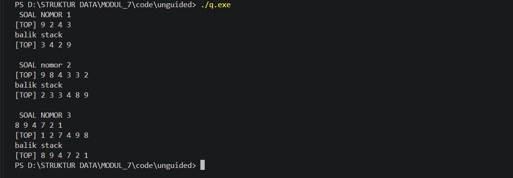
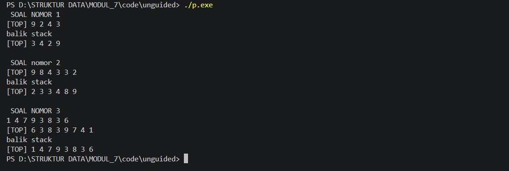

# <h1 align="center">Laporan Praktikum Modul 7 - Stack</h1>

<p align="center">Akhsan Sabili - 109082500062</p>

## Dasar Teori

Stack merupakan salah satu struktur data linear yang menerapkan prinsip Last In First Out (LIFO), yaitu data yang terakhir dimasukkan akan menjadi data pertama yang dikeluarkan [1]. Struktur data ini banyak digunakan dalam berbagai aplikasi komputer, seperti pengelolaan pemanggilan fungsi (function call), evaluasi ekspresi aritmatika, dan mekanisme undo-redo pada perangkat lunak [1].

### A. Konsep Stack<br/>

stack dapat diibaratkan seperti tumpukan piring, di mana piring yang terakhir diletakkan di atas akan menjadi piring pertama yang diambil. Pada struktur data stack, hanya terdapat satu titik akses yaitu bagian atas (top), sehingga seluruh operasi dilakukan melalui posisi tersebut [2].

#### 1. Push
Push merupakan operasi untuk menambahkan elemen baru ke bagian atas stack. Jika stack masih memiliki ruang kosong, data dapat dimasukkan dan posisi top akan berpindah ke elemen yang baru ditambahkan [2].

#### 2. Pop
Pop adalah operasi untuk menghapus elemen yang berada pada bagian atas stack. Setelah elemen dihapus, posisi top akan bergeser ke elemen sebelumnya. Operasi ini mencerminkan prinsip LIFO yang menjadi karakteristik utama stack [1].

#### 3. Peek 
Peek digunakan untuk melihat elemen yang berada pada posisi teratas tanpa menghapusnya dari stack [3]

### B. Implementasi stack<br/>

#### 1. stack dengan array
Implementasi stack menggunakan array memanfaatkan indeks untuk menunjukkan posisi elemen teratas. Metode ini sederhana dan memiliki proses akses yang cepat, tetapi kapasitas penyimpanan bersifat tetap sesuai ukuran array yang telah ditentukan [2].

#### 2. Stack dengan Linked List
Pada implementasi linked list, setiap elemen stack disimpan dalam node yang saling terhubung. Pendekatan ini memungkinkan ukuran stack bertambah atau berkurang secara dinamis sesuai kebutuhan program [3].


## Guided 1

### 1. stack.h

```C++
#ifndef STACK_TABLE
#define STACK_TABLE
#include <iostream>
using namespace std;
const int MAX = 10;

struct stackTable
{
    int data[MAX];
    int top;
};
bool isEmpty(stackTable s);
bool isFull(stackTable s);
void createStack(stackTable &s);
void push(stackTable &s, int angka);
void pop(stackTable &s);
void update(stackTable &s, int posisi);
void view(stackTable s);
void searchData(stackTable s, int data);
#endif 
```

### 2. stack.cpp

```C++

#include "stack.h"
#include <iostream>
using namespace std;

bool isEmpty(stackTable s)
{
    return s.top == -1;
}
bool isFull(stackTable s)
{
    return s.top == MAX - 1;
}
void createStack(stackTable &s)
{
    s.top = -1;
}
void push(stackTable &s, int angka)
{

    if (isFull(s))
    {
        cout << "Stack penuh!" << endl;
    }
    else
    {
        s.top++;
        s.data[s.top] = angka;
        cout << "Data" << angka << "berhasil ditambahkan kedalam stack !" << endl;
    }
}

void pop(stackTable &s)
{
    if (isEmpty(s))
    {
        cout << "Stack kosong!" << endl;
    }
    else
    {
        int val = s.data[s.top];
        s.top--;
        cout << "Data" << val << " berhasil dihapus dari stack!" << endl;
    }
}

void update(stackTable &s, int posisi)
{
    if (isEmpty(s))
    {
        cout << "Stack kosong!" << endl;
    }
    if (posisi <= 0)
    {
        cout << "Posisi tidak valid!" << endl;
        return;
    }
    // index = top

      int idx = s.top - (posisi - 1);
      if (idx < 0 || idx > s.top)
      {
          cout << "Posisi " << posisi << " tidak valid!" << endl;
          return;
      }

      cout << "Update data posisi ke-" << posisi << endl;
      cout << "Masukkan angka : ";
      cin >> s.data[idx];
      cout << "Data berhasil diupdate!" << endl;
      cout << endl;
  }

  void view(stackTable s)
  {
      if (isEmpty(s))
      {
          cout << "Stack kosong!" << endl;
      }
      else
      {
          for (int i = s.top; i >= 0; --i)
          {
              cout << s.data[i] << " ";
          }
      }
      cout << endl;
  }

  void searchData(stackTable s, int data)
  {
      if (isEmpty(s))
      {
          cout << "Stack kosong!" << endl;
          return;


      cout << "Mencari data " << data << "..." << endl;
      int posisi = 1;
      bool found = false;

      for (int i = s.top; i >= 0; --i)
      {
          if (s.data[i] == data)
          {
              cout << "Data " << data << " ditemukan pada posisi ke-" << posisi << endl;
              cout << endl;
              found = true;
              break;
          }
          posisi++;
      }

      if (!found)
      {
          cout << "Data " << data << " tidak ditemukan didalam stack!" << endl;
          cout << endl;
      }
    }
}

```

### 3. main.cpp

```C++
#include "stack.h"
#include <iostream>

using namespace std;

int main()
{
    stackTable s;
    createStack(s);

    push(s, 1);
    push(s, 2);
    push(s, 3);
    push(s, 4);
    push(s, 5);
    cout << endl;

    cout << "--- Stack setelah push ---" << endl;
    view(s);
    cout << endl;

    pop(s);
    pop(s);
    cout << endl;

    cout << "--- Stack setelah pop 2 kali ---" << endl;
    view(s);
    cout << endl;

    update(s, 2);
    update(s, 1);
    cout << endl;

    cout << "--- Stack setelah update ---" << endl;
    view(s);
    cout << endl;

    searchData(s, 4);
    searchData(s, 9);

    return 0;
}
```

Program diatas adalah implementasi dari stack. Pada stack.h didefinisikan struktur stackTable yang memiliki array data berukuran 10 elemen dan variabel top sebagai penunjuk posisi data paling atas dalam stack. Selanjutnya pada stack.cpp terdapat berbagai fungsi untuk mengelola stack seperti createStack untuk membuat stack kosong push untuk menambahkan data pop untuk menghapus data teratas update untuk mengubah data pada posisi tertentu view untuk menampilkan isi stack dan searchData untuk mencari data dalam stack Pada main.cpp program membuat sebuah stack kemudian menambahkan data dari 1 hingga 5 menghapus dua data teratas melakukan perubahan data pada posisi tertentu dan menampilkan hasilnya serta melakukan pencarian data yang ada di dalam stack. Program ini menunjukkan konsep LIFO dimana data yang terakhir masuk akan menjadi data pertama yang keluar dari stack

## Guided 2

### 1. stack.h

```C++
#ifndef STACK
#define STACK
#define Nil NULL

#include <iostream>
using namespace std;

typedef struct node *address;
struct node
{
    int dataAngka;
    address next;
};

struct stack
{
    address top;
};

bool isEmpty(stack listStack);
void createStack(stack &listStack);
address alokasi(int angka);
void dealokasi(address &node);

void push(stack &listStack, address nodeBaru);
void pop(stack &listStack);
void update(stack &listStack, int posisi);
void view(stack listStack);
void searchData(stack listStack, int data);

#endif
```

### 2. stack.cpp

```C++
#include "stack.h"
#include <iostream>

using namespace std;

#include "stack.h"
#include <iostream>

using namespace std;

bool isEmpty(stack listStack)
{
    if (listStack.top == Nil)
    {
        return true;
    }
    else
    {
        return false;
    }
}

void createStack(stack &listStack)
{
    listStack.top = Nil;
}

address alokasi(int angka)
{
    address nodeBaru = new node;
    nodeBaru->dataAngka = angka;
    nodeBaru->next = Nil;
    return nodeBaru;
}

void dealokasi(address &node)
{
    node->next = Nil;
    delete node;
}

void push(stack &listStack, address nodeBaru)
{
    nodeBaru->next = listStack.top;
    listStack.top = nodeBaru;
    cout << "Node " << nodeBaru->dataAngka << " berhasil ditambahkan kedalam stack!" << endl;
}

void pop(stack &listStack)
{
    address nodeHapus;
    if (isEmpty(listStack) == true)
    {
        cout << "Stack kosong!" << endl;
    }
    else
    {
        nodeHapus = listStack.top;
        listStack.top = listStack.top->next;
        nodeHapus->next = Nil;
        dealokasi(nodeHapus);
        cout << "node " << nodeHapus->dataAngka << " berhasil dihapus dari stack!" << endl;
    }
}

void update(stack &listStack, int posisi)
{
    if (isEmpty(listStack) == true)
    {
        cout << "Stack kosong!" << endl;
    }
    else
    {
        if (posisi == 0)
        {
            cout << "Posisi tidak valid!" << endl;
        }
        else
        {
            address nodeBantu = listStack.top;
            int count = 1;
            bool found = false;
            while (nodeBantu != Nil)
            {
                if (count < posisi)
                {
                    nodeBantu = nodeBantu->next;
                    count++;
                }
                else if (count == posisi)
                {
                    cout << "Update node poisisi ke-" << posisi << endl;
                    cout << "Masukkan angka : ";
                    cin >> nodeBantu->dataAngka;
                    cout << "Data berhasil diupdate!" << endl;
                    cout << endl;
                    found = true;
                    break;
                }
            }
            if (found == false)
            {
                cout << "Posisi " << posisi << " tidak valid!" << endl;
            }
        }
    }
}

void view(stack listStack)
{
    if (isEmpty(listStack) == true)
    {
        cout << "List kosong!" << endl;
    }
    else
    {
        address nodeBantu = listStack.top;
        while (nodeBantu != Nil)
        {
            cout << nodeBantu->dataAngka << " ";
            nodeBantu = nodeBantu->next;
        }
    }
    cout << endl;
}

void searchData(stack listStack, int data)
{
    if (isEmpty(listStack) == true)
    {
        cout << "List kosong!" << endl;
    }
    else
    {
        address nodeBantu = listStack.top;
        int posisi = 1;
        bool found = false;
        cout << "Mencari data " << data << "..." << endl;
        while (nodeBantu != Nil)
        {
            if (nodeBantu->dataAngka == data)
            {
                cout << "Data " << data << " ditemukan pada posisi ke-" << posisi << endl;
                found = true;
                cout << endl;
                break;
            }
            else
            {
                posisi++;
                nodeBantu = nodeBantu->next;
            }
        }
        if (found == false)
        {
            cout << "Data " << data << " tidak ditemukan didalam stack!" << endl;
            cout << endl;
        }
    }
}
```

### 3. main.cpp

```C++
#include "stack.h"
#include <iostream>

using namespace std;

int main()
{
    stack listStack;
    address nodeA, nodeB, nodeC, nodeD, nodeE = Nil;
    createStack(listStack);

    nodeA = alokasi(1);
    nodeB = alokasi(2);
    nodeC = alokasi(3);
    nodeD = alokasi(4);
    nodeE = alokasi(5);

    push(listStack, nodeA);
    push(listStack, nodeB);
    push(listStack, nodeC);
    push(listStack, nodeD);
    push(listStack, nodeE);
    cout << endl;

    cout << "--- Stack setelah push ---" << endl;
    view(listStack);
    cout << endl;

    pop(listStack);
    pop(listStack);
    cout << endl;

    cout << "--- Stack setelah pop 2 kali ---" << endl;
    view(listStack);
    cout << endl;

    update(listStack, 2);
    update(listStack, 1);
    update(listStack, 4);
    cout << endl;

    cout << "--- Stack setelah update ---" << endl;
    view(listStack);
    cout << endl;

    searchData(listStack, 4);
    searchData(listStack, 9);

    return 0;
}
```

Program ini dibuat untuk mengelola data menggunakan stack . Data dapat ditambahkan ke dalam stack dengan fungsi push, dihapus dengan pop, diubah nilainya dengan update, ditampilkan menggunakan view, dan dicari menggunakan searchData. Pada program utama, data 1 sampai 5 dimasukkan ke dalam stack, kemudian beberapa data dihapus, diubah, dan dicari untuk menunjukkan cara kerja stack yang menggunakan prinsip LIFO , yaitu data yang terakhir masuk akan menjadi data pertama yang keluar.


## Unguided

### 1. (Buatlah ADT Stack menggunakan ARRAY sebagai berikut di dalam file “stack.h”:)

#### stack.h

```C++
#ifndef STACK_H
#define STACK_H

typedef int infotype;

struct Stack {
    infotype info[20];
    int top;
};

void createStack(Stack &S);
void push(Stack &S, infotype x);
infotype pop(Stack &S);
void printInfo(Stack S);
void balikStack(Stack &S);

void pushAscending(Stack &S, infotype x);
void getInputStream(Stack &S);

#endif
```

#### stack.cpp

```C++

#include <iostream>
#include "stack.h"
using namespace std;

void createStack(Stack &S) {
    S.top = -1;
}

void push(Stack &S, infotype x) {
    if (S.top < 19) {
        S.top++;
        S.info[S.top] = x;
    } else {
        cout << "Stack penuh!" << endl;
    }
}

infotype pop(Stack &S) {
    if (S.top >= 0) {
        infotype x = S.info[S.top];
        S.top--;
        return x;
    }

    return -1;
}

void printInfo(Stack S) {
    cout << "[TOP] ";

    for (int i = S.top; i >= 0; i--) {
        cout << S.info[i] << " ";
    }

    cout << endl;
}

void balikStack(Stack &S) {
    int kiri = 0;
    int kanan = S.top;

    while (kiri < kanan) {
        infotype temp = S.info[kiri];
        S.info[kiri] = S.info[kanan];
        S.info[kanan] = temp;

        kiri++;
        kanan--;
    }
}

void pushAscending(Stack &S, infotype x) {
    Stack temp;
    createStack(temp);

    while (S.top >= 0 && S.info[S.top] > x) {
        push(temp, pop(S));
    }

    push(S, x);

    while (temp.top >= 0) {
        push(S, pop(temp));
    }
}

void getInputStream(Stack &S) {
    char karakter;

    while (cin.get(karakter) && karakter != '\n') {
        if (karakter >= '0' && karakter <= '9') {
            push(S, karakter - '0');
        }
    }
}

```

#### main.cpp

```C++

#include <iostream>
#include "stack.h"
using namespace std;

int main() {
    Stack S;

    cout << " SOAL NOMOR 1 " << endl;
    createStack(S);
    push(S, 3);
    push(S, 4);
    push(S, 8);
    pop(S);
    push(S, 2);
    push(S, 3);
    pop(S);
    push(S, 9);
    printInfo(S);
    cout << "balik stack" << endl;
    balikStack(S);
    printInfo(S);

    cout << "\n SOAL nomor 2" << endl;

    createStack(S);
    pushAscending(S, 3);
    pushAscending(S, 4);
    pushAscending(S, 8);
    pushAscending(S, 2);
    pushAscending(S, 3);
    pushAscending(S, 9);
    printInfo(S);
    cout << "balik stack" << endl;
    balikStack(S);
    printInfo(S);

    cout << "\n SOAL NOMOR 3" << endl;

    createStack(S);
    getInputStream(S);
    printInfo(S);
    cout << "balik stack" << endl;
    balikStack(S);
    printInfo(S);

    return 0;
}

```

### Output Unguided 1 :

##### Output 1



##### Output 2



Program diatas adalah implementasi stack menggunakan array. Pada soal pertama, program melakukan operasi dasar Stack seperti push, pop, menampilkan isi stack, dan membalik urutannya. Pada soal kedua, program menggunakan pushAscending() untuk memasukkan data secara berurutan dari nilai terkecil hingga terbesar. Pada soal ketiga, program menggunakan getInputStream() untuk menerima input angka dari pengguna sampai tombol Enter ditekan. Ketiga soal dijalankan secara berurutan dalam satu file main.cpp 

## Kesimpulan

Berdasarkan praktikum yang telah saya lakukan, saya dapat memahami konsep dan cara kerja struktur data stack yang menggunakan prinsip Last In First Out (LIFO). Saya berhasil mengimplementasikan stack menggunakan array dan linked list serta menerapkan berbagai operasi seperti push, pop, update, pencarian data, dan menampilkan isi stack. Melalui praktikum ini saya juga memahami perbedaan implementasi stack menggunakan array yang memiliki kapasitas tetap dan linked list yang bersifat dinamis. Praktikum ini membantu saya memahami penggunaan stack sebagai salah satu struktur data yang sering digunakan dalam berbagai aplikasi pemrograman.

## Referensi

[1] N. Z. Jhanjhi, S. N. Brohi, dan M. Humayun, “Data Structures and Their Applications in Computer Science,” International Journal of Advanced Computer Science and Applications, vol. 10, no. 5, pp. 1–7, 2019.

<br>[2] R. Kumar dan S. K. Singh, “A Study of Stack Data Structure and Its Applications,” International Journal of Computer Applications, vol. 182, no. 44, pp. 20–23, 2019.

<br>[3] A. Sharma dan P. Gupta, “Implementation and Analysis of Stack Using Array and Linked List,” International Journal of Innovative Technology and Exploring Engineering, vol. 8, no. 9, pp. 2278–3075, 2019.
